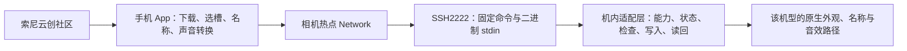

# 其他机型开发者接入文档

基线：索尼云创 Android `0.1.0-preview`，2026-11-05。

[返回首页](README.md) · [用户使用说明](USER_GUIDE.zh-CN.md)

本文说明如何适配索尼云创的“手机管理素材、机内完成实际修改”设计。应用闭源；本仓库提供接口约定与联调要求，不提供 App 或机内实现源码。

**当前预览包面向 A7C II，不是已经支持所有机型的通用包。** 它仍有固定的连接配置、命令入口及 A7C II 素材校验。其他机型的机内服务和素材准备好以后，还需要与 App 维护者完成客户端登记、格式校验及界面联调。实现同名命令不等于已经接入成功。

## 1. 分工与最小接入路线



| 手机端负责 | 机内适配端负责 |
| --- | --- |
| 社区与本地素材、文件校验和转换 | 自己机型的程序、资源、挂载和存储布局 |
| 选择槽位、名称、快门类型 | 原生槽位、基底、预览／照片／名称及音效路由 |
| 可选 BLE 配对、加入 Wi-Fi、绑定网络 | 设备端连接服务、身份、执行环境和服务启停 |
| 固定业务命令与小素材载荷 | 目标检查、写入、读回、任务持久化和重新加载 |
| 呈现真实结果，不自动重发未知写入 | 区分未开始、进行中、部分失败及完成状态 |

手机不应接收、计算或发送机型的固件偏移，也不负责上传整份 AP／CP 或安装／恢复固件。适配工作应留在机内组件和该机型自身的安装流程。

建议按下列顺序接入：

1. 明确本机型的执行环境、组件安装与恢复方式，先完成离线研究。
2. 先用手动 Wi-Fi，完成 SSH 与只读 `info`／`task`；BLE 自动开热点可以后做。
3. 分别实现已确认的外观和音效能力。不支持的功能如实上报并拒绝调用。
4. 向 App 维护者提交目标素材定义、接口样例与验证结果，完成专门测试包的联调。
5. 再按实际机身分阶段验证写入、冷启动和图像／声音效果。

不用为接入建立传图、PTP 或 DLNA 服务；也不需要新增业务 API 版本号、整份固件哈希白名单或常驻 HTTP 服务。

## 2. 当前预览包的兼容边界

| 项目 | 当前行为 | 适配者需要做什么 |
| --- | --- | --- |
| 网络 | 相机本地 IPv4；识别 10/8、172.16/12、192.168/16、169.254/16 | 上报／使用真实热点地址；IPv6 或其他地址方案需客户端配合 |
| SSH | 固定 TCP2222、密码认证，首次确认后保存主机身份 | 与维护者对齐接入配置；客户端暂无自定义账号／密码入口 |
| 认证材料 | App 预览包的认证参数固定，`info` 不负责下发密码 | 不要只修改服务端凭据就认为现有 APK 能连；联调时通过约定渠道对齐配置，不把凭据放进文档或 Issue |
| 命令路径 | `/usr/bin/a7c2-api` | 名称属于现有兼容入口；其他机型可提供转发入口。单独改名需要同步客户端 |
| 外观槽位 | C2 后端支持 1–6，App 查询 `slots` 并核对所选槽；未取得能力时界面默认列 1–6 | 只上报实际支持的槽位；其他数量和空能力的界面要联调 |
| 音效界面 | 预览界面保留机械／电子选项，写入前检查 `sound_operations` | `sound` 子集尚未在所有 UI 入口动态禁用；机内必须拒绝不支持的 scope，客户端需补齐相应显示 |
| 素材 | `.a7look` 校验仍固定 C2 目标和当前编码 | 新机型素材校验／分发必须由 App 维护者接入；不能改字段伪装成 C2 |
| 状态 | 写入成功回复固定为 `pending_reload` | 本包没有通用即时生效握手；需要其他生效方式时先协商客户端行为 |

`info` 目前没有自动机型识别、凭据发现或插件下载机制。即使返回相同的槽位数组，也不能证明另一机型已经具备相同的图像处理语义。

## 3. 设备端连接与生命周期

设备端需要在对应 Wi-Fi 就绪时提供可用 SSH 服务。当前设计按 Wi-Fi 事件启动／停止，不增加周期轮询、保活唤醒或默认后台扫描。

设备端 SSH 主机密钥应在正常重启后保持一致。手机首次确认并保存身份；每次启动都换主机密钥，会使客户端把后续连接当作不同设备。认证配置、主机私钥及具体安装方法由适配者与维护者另行对齐，不放进接入材料。

### BLE 是可选便利层

以下是已研究的 Sony 连接约定，当前 C2 实机仍待验证，不能视为每台 Sony 都支持：

| 项目 | 约定／用途 |
| --- | --- |
| 广播筛选 | Sony 厂商标识 `0x012D`，以及已识别的相机名称前缀 |
| 配对服务 | `8000EE00-EE00-FFFF-FFFF-FFFFFFFFFFFF` |
| 控制服务 | `8000CC00-CC00-FFFF-FFFF-FFFFFFFFFFFF` |
| EE01／EE03／EE04 | 配对请求、配对通知及相关能力；需处理相机端确认、Android bond 和重新发现服务 |
| CC08 | 写单字节 `01` 请求开启热点 |
| CC06／CC07 | 读 SSID／密码；当前解析去掉前三字节响应头及结尾空字符 |
| CC0C | 可选 BSSID，缺失时保留按 SSID 连接的路径 |

特征名按实际 UUID 前缀寻找，不把表中的前缀擅自补成未经核对的完整特征 UUID。当前参考配对请求中有 EE01 载荷 `06 08 01 00 00 00 00`；采用前必须核对自己机型的配对行为和通知，不能只复用字节就宣布兼容。

相机拒绝、特征缺失和超时必须明确返回，始终保留相机菜单开热点及手动连接。有限的只读重试不等于允许反复执行未知结果的写入。

### Wi-Fi 路由

Android 使用 `WifiNetworkSpecifier` 请求加入热点，取得对应 `Network` 后，将相机通信 socket 绑定到该网络。社区请求使用系统默认网络。不要把连上热点、互联网可用和业务接口可用混为一谈。

相机地址优先从该网络的路由／网关取得，其次允许用户明确填写；当前最后回退为 `192.168.122.1`。其他机型不能假定都使用这个地址。

## 4. 命令执行约定

通过 SSH exec 执行固定命令，**不分配 PTY**。业务输入是原始二进制 stdin；输出为 UTF-8 JSON，通常一行并带换行。日志放 stderr，不得混入 stdout。

发送载荷后必须关闭输入方向、发送 EOF。机内会读取完整载荷并检查是否存在额外字节；只发送固定长度但不结束 stdin，可能使命令继续等待。

| 命令 | stdin | 成功输出 |
| --- | --- | --- |
| `/usr/bin/a7c2-api info` | 空，EOF | 能力 JSON |
| `/usr/bin/a7c2-api task` | 空，EOF | 当前任务状态 JSON |
| `/usr/bin/a7c2-api look SLOT NAME` | 恰好 1324 字节，EOF | `{"state":"pending_reload"}` |
| `/usr/bin/a7c2-api sound SCOPE on` | 空，EOF | `{"state":"pending_reload"}` |
| `/usr/bin/a7c2-api sound SCOPE off` | 空，EOF | `{"state":"pending_reload"}` |
| `/usr/bin/a7c2-api sound SCOPE custom` | 原生 filter-0 音效，EOF | `{"state":"pending_reload"}` |

`SCOPE` 只使用 `mechanical`、`electronic`、`both`。`NAME` 是单个 UTF-8 参数，长度 1–63 字节，不能含值小于 32 的控制字符。名称中的空格、中文和单引号都应保留；构造远端命令必须正确引用参数，不能把名称当作 shell 内容拼接执行。

成功退出码为 0；失败为非零，并返回：

```json
{"state":"failed","error":"layout-conflict"}
```

客户端同时核对退出码与 JSON。连接关闭、读到 EOF、收到了任意 JSON，都不能单独代表写入成功。查询 `task` 正常返回 `failed` 状态时，查询本身仍可退出 0；它表达上一次任务的结果。

当前客户端输出等待有界，写入发出后的业务回复等待约 30 秒。若目标机型一次操作耗时超过此范围，需要与维护者调整等待／查询方案；不能在超时后自动重发解决。

## 5. 能力查询：info

完整能力示例：

```json
{
  "slots": [1, 2, 3, 4, 5, 6],
  "sound": ["mechanical", "electronic", "both"],
  "sound_operations": ["on", "off", "custom"],
  "native_photo": true
}
```

| 字段 | 类型 | 语义 |
| --- | --- | --- |
| `slots` | 整数数组 | 真正开放的外观槽位；不支持时为空数组 |
| `sound` | 字符串数组 | 实际支持的快门声音选择范围 |
| `sound_operations` | 字符串数组 | 实际支持的 `on`／`off`／`custom` 操作 |
| `native_photo` | 布尔值 | 是否完整实现下述原生照片参数语义；不是“仅认识这段数据” |

数组必须反映实际实现，不填占位功能。比如只完成开关但未实现自定义音效，就不要上报 `custom`。若不支持外观，可上报空 `slots`，并在机内拒绝任何 `look` 写入。

本接口不新增 `version`／`api_version`。下文素材文件中已有的 `schema` 是文件编码标识，与业务 API 版本号是不同概念。

## 6. 任务状态：task

无记录时：

```json
{"state":"idle"}
```

有记录时：

```json
{"state":"pending_reload","operation":"look"}
```

| 状态 | 当前语义 |
| --- | --- |
| `idle` | 没有记录中的素材更新任务 |
| `pending_reload` | 操作已完成，等待冷重启重新加载；此时不继续下一次写入 |
| `active` | 更新后已经观察到不同的启动身份；不证明照片、CP RAM 或扬声器效果已验收 |
| `failed` | 上次操作失败或无法确认结果，需要保留状态并检查 |

当前 C2 实现在开始修改前持久记录运行状态，完成后记录 `pending_reload`，根据重启前后的启动身份区分 `active`。对遗留运行状态，查询时会呈现为 `failed`，不会把中断当成完成。

机内必须串行化写入。任务状态与写锁配合，拒绝并发、未完成重新加载以及结果不明的上一任务。结果未知时，手机只保留提示并读取状态；用户确认读回状态不是自动清除机内失败记录，更不是回滚。

**这不是多文件原子事务承诺。** 当前 C2 资源更新失败可能已有部分文件修改；不能因为得到 `failed` 就声称未发生任何写入。适配者需给出自己的失败检查与恢复流程，不能简单删除锁或重放原请求。

## 7. 外观输入文件与机型登记

手机输入为 `.a7look` JSON，外层文件最多 8 MiB。当前预览包识别：

| 字段 | 当前要求 |
| --- | --- |
| `schema` | `a7c2-creative-look/1` |
| `target` | 恰含 `model: ILCE-7CM2` 与 `firmware: 2.01` |
| `base` | `ST` |
| `table_format` | `native-5x9x9-s7-planar` |
| `name` | 合法机内名称 |
| `table_base64` | 解码后恰好 1215 字节的原生校正表 |
| `native_photo` | 可选；若存在，必须是当前已支持的完整原生照片阶段及整数 runtime basis |

这里的 `2.01` 是当前素材目标字段，不能据此推断机身正在运行的版本，也不能推出跨固件任意位置都能写。

其他机型应准备自己拟合、标注目标并验证的素材，再与维护者约定客户端接受方式。不能把目标字段改成 C2、删除原生阶段或换扩展名来绕过校验。相同 LUT／DCP 也不保证在不同机型上有相同机内响应。

若目标机型的表大小或处理语义不同，需要约定独立的素材编解码与客户端适配；当前包不会自动把任意 3D LUT、任意原生曲线或其他相机表格转换为兼容载荷。

## 8. look 的 1324 字节载荷

全部多字节整数为小端有符号 int16，**没有 JSON、Base64、文件头、槽位或名称前缀**。槽位和名称只通过命令参数发送。

| 字节范围（含两端） | 长度 | 内容 |
| --- | --- | --- |
| 0–1214 | 1215 | 三个 405 字节的校正平面 |
| 1215 | 1 | 原生照片阶段标志，0 或 1 |
| 1216–1221 | 6 | 三个 tone Q10 控制值 |
| 1222–1275 | 54 | 三个 3×3 矩阵增量平面，逐平面、逐行排列，共 27 个 int16 |
| 1276–1323 | 48 | 三个八通道 chroma 平面，逐平面排列，共 24 个 int16 |

### 校正表

每个平面有 `5×9×9 = 405` 个节点，节点序号为 `i0×81 + i1×9 + i2`，索引范围分别为 0–4、0–8、0–8。先完整存第一平面，再第二、第三平面；不是每个节点连续存三个通道。

每个值以 int8 二进制补码保存，合法值为 **−64…63**。负值不能通过 `& 0x7f` 改成正值。布局与数值范围是当前素材约定，不代表真实 ISP 坐标和通道响应已经在其他机型上确认；适配者需要独立核对原生加载与效果。

### 原生照片阶段

标志为 0 时，当前 App 将后续 108 字节置零；机内应关闭所选槽位的该阶段，保留其他槽位，不把上一份原生参数继续当成新外观生效。

标志为 1 时，当前素材需要：

- 阶段标识：`a7c2-native-photo-relative/1`。
- 整数 basis：`a7c2-photo-q10-endpoint-uniform-matrix/1`。
- 三个 tone 参数：gain、toe、shoulder，范围各为 −1024…1024。
- 三个矩阵平面：文件中每平面六个整数，范围各为 −1024…1024；展开后的九个矩阵元素允许 −2048…2048。
- 三个八通道 chroma 平面：每值 −1024…1024。

文件中每个矩阵平面 `[a,b,c,d,e,f]` 展开为下列行序矩阵，再写入载荷：

```text
 a+b   -a    -b
 -c    c+d   -d
 -e    -f    e+f
```

这些是当前机内原生阶段相对于基底的参数，不是可以直接套到任意相机像素上的 RGB 矩阵。机内适配端应实现对应的原生曲线、矩阵、色度和槽位隔离语义；不能只接收字节但不处理阶段。

不支持该阶段时，上报 `native_photo:false`，收到带阶段的外观时在修改前拒绝，不能默默降级为只写色表。

### 机内应完成的工作

- 核对本机型的目标资源、表大小、挂载、可用空间与所选槽位，完成实际写入和读回。
- 正确处理槽位的基底、原生加载、名称编码及界面刷新／重启加载；这些动作不是手机上传 1215 字节就自动完成的。
- 保留未选槽位、其名称和参数；保留原厂外观、其他设置与校准内容。
- 分别验证预览、拍照、照片回放和名称；不能只看文件读回或名称变化。

当前手机没有单独的“将槽位改为 ST”命令。适配者应在安装／初始化流程或机内操作中保证素材声明的基底与实际保存、运行状态一致；不能因为文件写着 `base:ST` 就假定机身已切换，也不能顺带重置未选槽位。

具体地址、程序尺寸、资源编号和原生 ABI 全部属于目标机型的机内实现，不能照抄 C2 的偏移或把这些数据交给手机决定。

## 9. sound 的载荷与语义

### 开关

`on`／`off` 无二进制载荷。作用于所选机械、电子或两者范围；不能影响未选一侧。机械机构自身的声音与扬声器附加音效是不同路径。

### 自定义音效

`custom` 的 stdin 是以下原生 filter-0 数据，不是 WAV、MP3 或 PCM 文件：

| 项目 | 约定 |
| --- | --- |
| 总长度 | 大于 0，最多 51136 字节，是 64 的整数倍 |
| 编码块 | 每块 32 字节 |
| 第 0 字节 | 扩展指数 0–8，使用 filter-0，不使用 filter-1 预测器 |
| 后 31 字节 | int8 残差；软件解码值为残差乘 `2^指数` |
| 对齐 | 需要时追加一个完整的 32 字节零块，使总长度 64 字节对齐 |

当前手机侧按 24 kHz、单声道处理，片段最长 2 秒，2 ms 边缘淡入淡出；默认 40%／最大 50% 峰值。以该格式编码时，每 31 个样本一块，不足部分补零，选择能容纳该块样本的最小指数，并按最近值、半数取偶进行量化后限在 −128…127。

24 kHz 是当前软件约定，**不代表其他机型的播放采样率、解码器和声音路由已经确认**。若目标机型需要不同采样率、格式或容量，应与 App 维护者接入对应转换方式，不能让既有预览包在错误采样率下直接播放。

机内适配者应分别确认机械／电子路径、开始与停止事件、缓冲区容量及寿命、资源引用和配置发布顺序。当前 C2 为机械侧保留附加关闭段，因此对外载荷上限为 51136；适配端不能忽略自己额外需要的存储。

不要假定写入音频文件就是完成全部动作：后续配置发布或声音开关仍可能失败，需记录并报告真实结果。

## 10. 错误语义

建议沿用已存在且适用的错误名，并补充本机型确有必要的诊断。不要用成功 JSON 掩盖部分失败。

| 类别 | 当前错误示例 | 处理原则 |
| --- | --- | --- |
| 输入 | `arguments`、`slot`、`name`、`look-size`、`look-range`、`photo-range`、`audio-size`、`audio-codec` | 输入无效时在修改前拒绝 |
| 能力 | `photo-unavailable`、`custom-unavailable` | 不支持时明确拒绝，不能静默忽略 |
| 状态 | `busy`、`pending-reload`、`previous-result-unknown` | 不自动重放写入；先核对运行／重新加载状态 |
| 目标与存储 | `layout-size`、`layout-conflict`、`table-layout`、`name-layout`、`no-space` | 按本机实际结构核对，不以哈希白名单替代实际修改目标检查 |
| 执行与读回 | `read`、`write`、`readback`、`mount-rw`、`mount-ro`、`task-write` | 保留任务记录与已经完成的阶段，不能假定全部回滚 |

失败后未必可以立即重试。恢复挂载状态或发布结果失败，也属于需要反馈的失败。

## 11. 与 App 维护者对接时提交什么

| 材料 | 最少内容 |
| --- | --- |
| 目标说明 | 准确机型、实际固件范围、组件执行平台与安装／卸载方式 |
| 能力 | 真实 `info` 示例；逐项标出未实现的能力 |
| 连接 | 手动 Wi-Fi 能否工作、热点地址获取方式、服务生命周期、BLE 是否需要差异处理 |
| 素材 | 本机型目标标识、编码／尺寸／阶段含义，以及合成的合法和非法样本 |
| 状态 | `idle`、`pending_reload`、`active`、失败与中断的真实回复样例 |
| 结果 | 离线、模拟器／VM、机内工具读回、物理拍照／听音分别列出 |
| 客户端需求 | 固定接入配置是否需调整、素材校验、槽位数量、音效类型及界面提示差异 |

接入材料不用包含完整原厂固件、机身备份、校准、私钥、账号密码或私人照片。可以提供协议样例与合成数据，具体实现源码由各开发者自行管理。

## 12. 验证阶段与接入完成标准

| 阶段 | 检查内容 | 能说明什么 |
| --- | --- | --- |
| 离线格式 | 固定长度、字节顺序、全部参数、边界值、中文和引号名称 | 解析和载荷合同一致 |
| 模拟接口／传输 | SSH 二进制与 EOF、JSON 和退出码、失败、断线、不自动重发 | 客户端及传输处理符合约定 |
| 本机只读接口 | 热点、实际 SSH、真实 `info`／`task`、连接关闭和 Wi-Fi 事件 | 对应机身确有接口；不证明可写或有效果 |
| 所选素材写入 | 最小受控素材、目标资源读回、其他槽位和设置保留、失败状态 | 本次写入的具体结果 |
| 冷启动及效果 | 重开与重新连接、名称、预览、照片／回放、机械与电子听音分别检查 | 对应机身和场景的实际可用性 |

当前 App 的已有证据为 12 项单元测试、Android 10／15 各 42 项模拟器检查及 10 个 UI 场景；其中 SSH 对端是电脑本地模拟接口。它们不是 C2 或其他机型的实机验收。

接入完成需要：机内实现、客户端联调、对应机身实际连接、素材写入及重启后效果均有独立结果。报告必须说明机型和固件范围，不能把某一机型、某一阶段或某一份素材的通过扩大成全部兼容。
